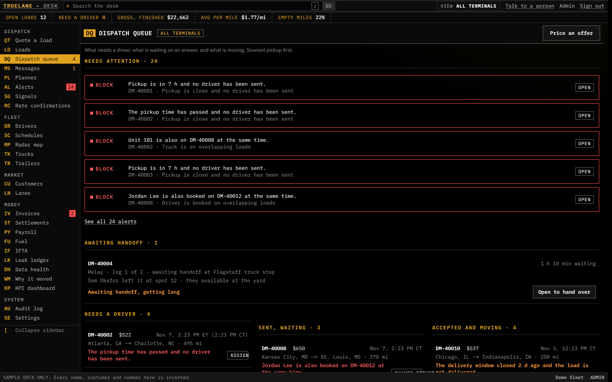
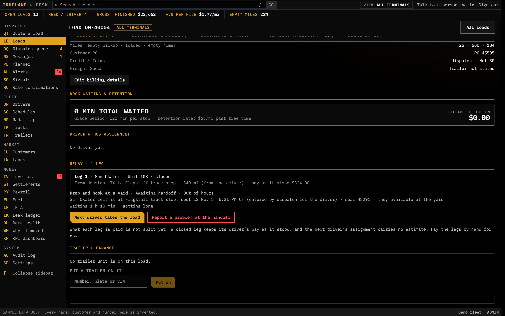
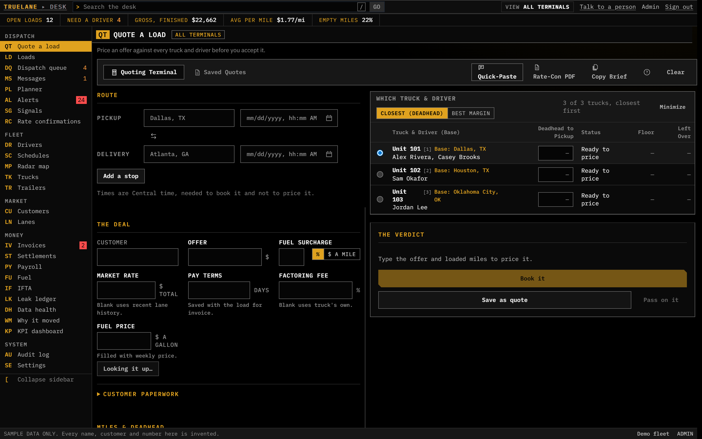
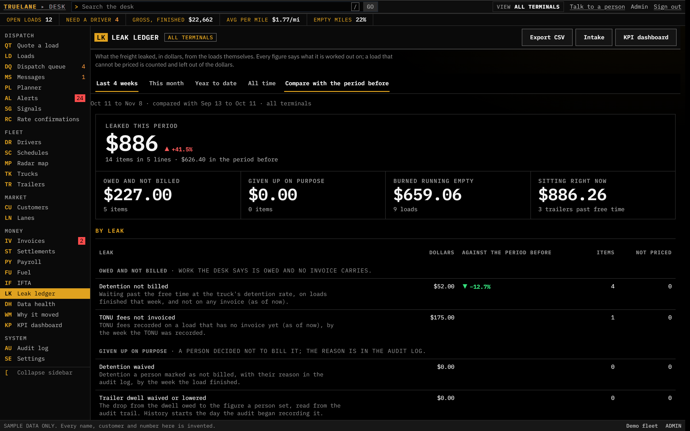
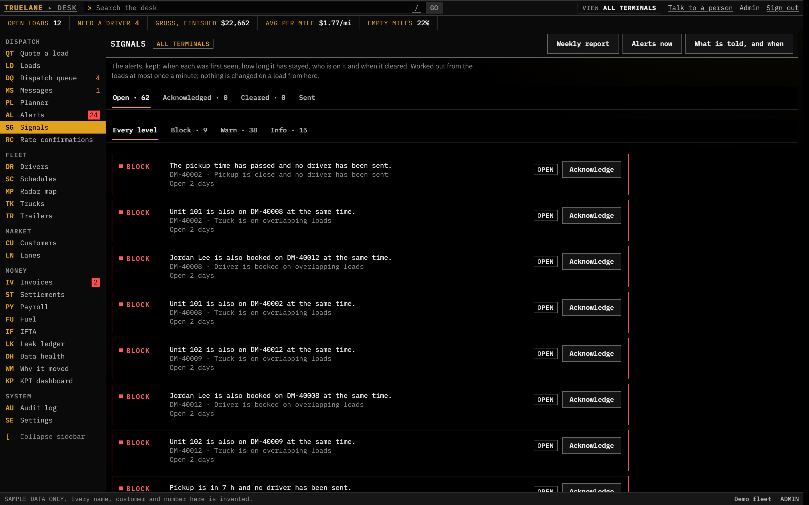
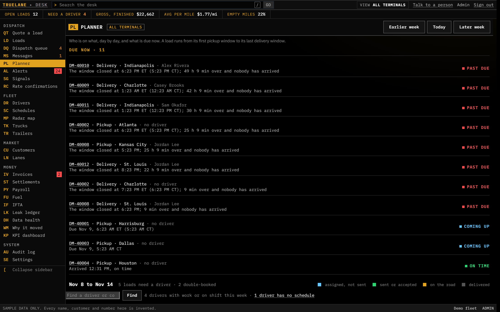
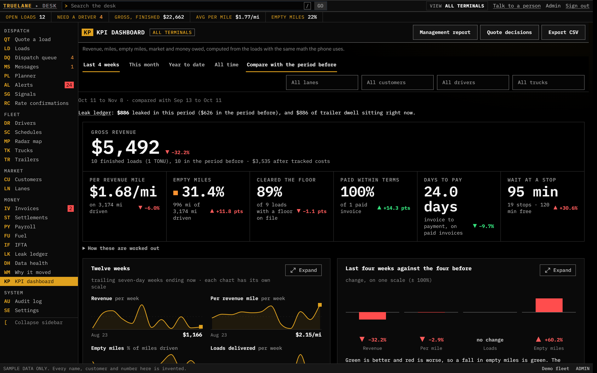
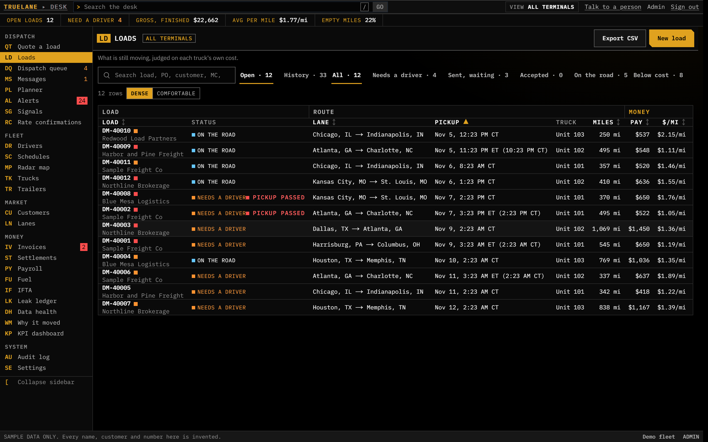
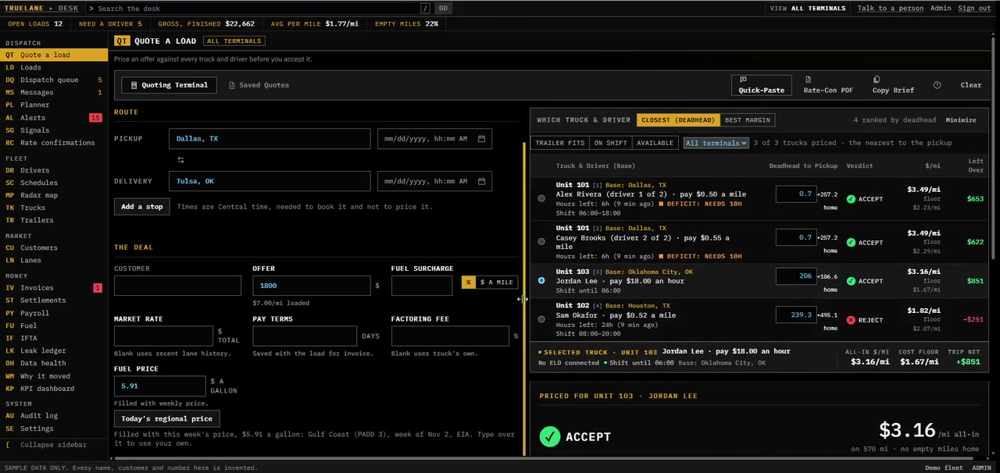

# TrueLane Dispatch Desk

**One screen for the whole fleet: what is waiting, what is moving, and where the money leaks.**
A dispatch and freight-intelligence desk for asset carriers, fleets and independent dispatchers.

[Website](https://truelane-three.vercel.app/build.html) · [Book a walkthrough](https://calendly.com/cm145571/new-meeting) · [Screens](#screens) · [Features](#what-it-does) · [The driver app](https://github.com/christopher-mcdaniel/TrueLane-Driver-App-iOS) · [Contact](#contact)

> **This is a showcase repository.** It shows what the Desk does, how it is built and what it looks like, using sample data. The source code is private and is not published here.

---

## Why it exists

Most carriers run a TMS, a fuel-card portal, an ELD and a pile of spreadsheets, and the money slips between them: detention that was never billed, trucks running empty, loads booked under the truck's own cost. The Desk reads all of it in one place, puts a dollar figure on each leak, and tells the dispatcher while there is still time to act.

## What it does

**Dispatch**
- **Dispatch queue.** What needs a driver, what is waiting on an answer and what is moving, soonest pickup first, with the one thing wrong with each load in plain words.
- **Quote with a verdict.** Every offer priced against what each truck really costs: *accept*, *caution* or *reject*, with the basis shown.
- **Planner and radar map.** Drivers by day, shifts and time off, trucks and trailers on the map.
- **Rate confirmations, read.** A rate confirmation in, a checked load out.

**Relays and recalls**
- **Recall without losing the record.** A driver sent a load by mistake can be taken off it with a reason code; the load returns to the queue, the driver link is told, and who held it, when and why is kept.
- **A digital baton for relays.** When a load changes hands (drop and hook, breakdown rescue, driver swap) the handoff is recorded with the place, seal, trailer, miles and who entered each figure. If the incoming driver reports damage or a broken seal, the baton freezes as found and dispatch must acknowledge it before the load moves on.

**Where the money leaks**
- **Leak ledger.** Detention not billed, empty miles, loads booked under the floor and trailers sitting too long, each in dollars and each saying how it was worked out.
- **Signals.** The same rules kept over time, with who is on each one, and a weekly leak report. Notifications go out through Slack, email or your own workflow tool once a channel is connected.
- **Detention evidence.** The truck's track at each stop, frozen and hashed so a detention claim can be proven.
- **KPI dashboard and why-it-moved.** What changed this period, broken into effects that add up to the change to the cent.

**Running the operation**
- Driver shifts and codes, schedules, terminals and per-person scope.
- Invoices, settlements and driver pay, fuel and IFTA.
- Customers and lanes, trailers with their asset history, and a data-health check that says what the desk cannot yet tell.
- A full audit log of what changed, by whom and why.

## Screens

All screens use invented sample data.

| | |
| --- | --- |
|  **A load waiting in a yard for its next driver.** The leg that closed, the baton, and the two next steps. |  **Quote with a verdict.** An offer priced against each truck's own cost. |
|  **Leak ledger.** What the freight leaked, in dollars, and how each figure was worked out. |  **Signals.** Rules that keep watching, with a history of who is on each. |
|  **Planner.** Drivers by day, with shifts and clashes shown. |  **KPI dashboard.** The period at a glance, with what moved it. |
|  **Loads board.** Every load by state, with the driver and truck. |  **Walkthrough video.** Click to play. |

## How it is built

- **Next.js and TypeScript**, server components and server actions, with Prisma on **PostgreSQL**.
- **Safe by construction.** Every write is made from the state it was read in, inside one transaction with its audit entry, so a double click or a second dispatcher cannot move a load twice.
- **Honest numbers.** Money is held in whole cents; a figure the desk cannot work out is counted as unknown, never guessed; each figure says where it came from.
- **Roles and scope.** Dispatch, billing, driver manager and viewer roles, with a person limited to some terminals seeing only those.
- **Tested.** More than 2,300 automated tests, including database tests for the dispatch, relay and money paths.
- **Built to connect.** A driver link to the phone app, and seams for ELD, fuel cards, factoring and payroll partners.

## Status

A working product in active development, shown here on sample data. The Read-and-Signals service for carriers who keep their own TMS is described on the [carriers page](https://truelane-three.vercel.app/consulting.html).

## Contact

**Christopher McDaniel** · Founder, Dallas–Fort Worth
Building web products, mobile apps and automations for freight and field businesses.
[LinkedIn](https://www.linkedin.com/in/build-with-chris) · [truelane-three.vercel.app](https://truelane-three.vercel.app) · c.mcdaniel.tx@outlook.com

---

© 2026 TrueLane. All rights reserved. See [LICENSE](LICENSE). The source code is not open source.
